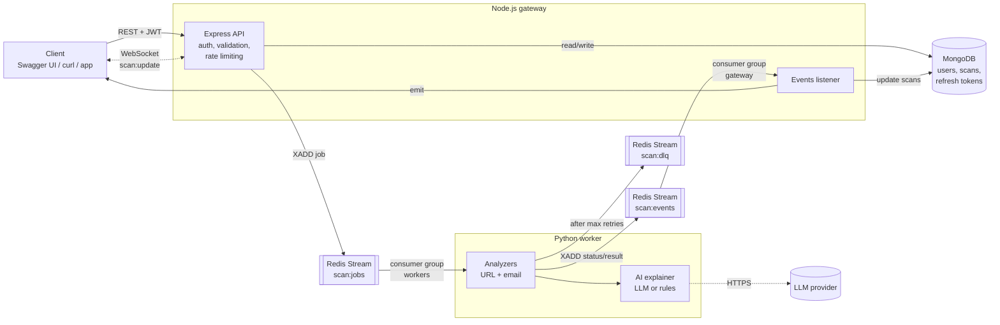
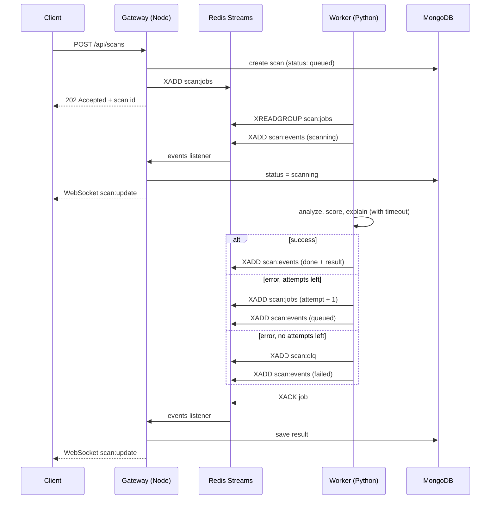

# ThreatLens

**AI-powered phishing and URL threat scanner built as an event-driven, multi-service system.**

Submit a suspicious URL or a raw email. ThreatLens queues the scan, a Python worker analyzes it with security heuristics, an LLM explains the result in plain English, and the verdict is pushed back to you in real time over WebSockets.


---

## Table of contents

- [Features](#features)
- [Architecture](#architecture)
- [Tech stack](#tech-stack)
- [Quick start](#quick-start)
- [Using the API](#using-the-api)
- [Real-time updates](#real-time-updates)
- [Enabling AI explanations](#enabling-ai-explanations)
- [How detection works](#how-detection-works)
- [Running without Docker](#running-without-docker)
- [Testing](#testing)
- [Configuration](#configuration)
- [Design decisions](#design-decisions)
- [Security measures](#security-measures)
- [Limitations and roadmap](#limitations-and-roadmap)
- [Project structure](#project-structure)

---

## Features

- **URL scanning**: lookalike/typosquat domains (`paypa1.com`), brand names on unrelated domains (`paypal.com.verify-account.xyz`), IP-based URLs, suspicious TLDs, punycode, random-looking domains, `@` tricks, DNS and SSL certificate checks.
- **Email scanning**: SPF / DKIM / DMARC results, sender spoofing (From vs Reply-To / Return-Path), brand impersonation in the display name, link text that hides the real destination, suspicious links, dangerous attachments, urgency language.
- **Risk score (0 to 100) and verdict**: `safe`, `suspicious` or `malicious`, with every finding listed.
- **AI explanations**: OpenAI, Anthropic or Gemini, with an automatic rule-based fallback.
- **Asynchronous processing** over Redis Streams with retries, timeouts, crash recovery and a dead-letter queue.
- **Real-time status** (`queued → scanning → done / failed`) over Socket.IO.
- **Secure auth**: JWT access tokens plus rotating refresh tokens with reuse detection.
- **Swagger UI** for exploring and testing the API.
- **One-command setup** with Docker Compose, plus unit tests and GitHub Actions CI.

---

## Architecture



### Scan lifecycle



**Key rule:** the gateway never calls the worker directly, and the worker never touches MongoDB. They only communicate through Redis Streams, so each service can be deployed, scaled and restarted independently.

---

## Tech stack

| Layer | Technology |
|---|---|
| API gateway | Node.js 20, TypeScript, Express, Zod, Socket.IO, Mongoose, ioredis, Pino |
| Auth & security | JWT (access + refresh rotation), bcrypt, Helmet, express-rate-limit, CORS |
| Worker | Python 3.12, redis-py, tldextract, dnspython, requests |
| AI | OpenAI / Anthropic / Gemini (pluggable) with rule-based fallback |
| Messaging | Redis Streams (consumer groups, XAUTOCLAIM, dead-letter stream) |
| Database | MongoDB 7 |
| DevOps | Docker, Docker Compose, GitHub Actions |
| Testing | Jest, Supertest, pytest |

---

## Quick start

**Prerequisites:** [Docker Desktop](https://www.docker.com/products/docker-desktop/) (includes Docker Compose).

```bash
git clone https://github.com/<akshaysen1740-blip>/threatlens.git
cd threatlens
docker compose up --build
```

That's it. No `.env` file is required: every setting has a working default.

| Service | URL |
|---|---|
| Swagger UI | http://localhost:4000/docs |
| API | http://localhost:4000/api |
| Health | http://localhost:4000/health/ready |

Stop with `Ctrl+C`, or run in the background with `docker compose up -d --build` and stop with `docker compose down`.

**Scale the workers** (Redis consumer groups split the jobs between them automatically):

```bash
docker compose up -d --build --scale worker=3
```

---

## Using the API

The easiest way is **Swagger UI** at http://localhost:4000/docs:

1. Call `POST /api/auth/register` with an email and password (min 8 chars, one letter, one number).
2. Copy the `accessToken` from the response, click **Authorize**, paste it.
3. Call `POST /api/scans`, then `GET /api/scans/{id}` to see the result.

### Same flow with curl

```bash
# 1. Register (or use /api/auth/login) and save the access token
TOKEN=$(curl -s -X POST http://localhost:4000/api/auth/register \
  -H "Content-Type: application/json" \
  -d '{"email":"demo@example.com","password":"Demo12345"}' | jq -r .accessToken)

# 2. Scan a URL -> returns 202 with status "queued"
SCAN_ID=$(curl -s -X POST http://localhost:4000/api/scans \
  -H "Authorization: Bearer $TOKEN" -H "Content-Type: application/json" \
  -d '{"type":"url","url":"http://paypa1-secure-login.xyz/verify-account"}' | jq -r .id)

# 3. Get the result (usually ready within a second or two)
curl -s http://localhost:4000/api/scans/$SCAN_ID -H "Authorization: Bearer $TOKEN" | jq

# 4. Scan the sample phishing email
jq -Rs '{type:"email", rawEmail: .}' samples/phishing-email.eml | \
  curl -s -X POST http://localhost:4000/api/scans \
    -H "Authorization: Bearer $TOKEN" -H "Content-Type: application/json" -d @- | jq

# 5. List your scans
curl -s "http://localhost:4000/api/scans?page=1&limit=10" -H "Authorization: Bearer $TOKEN" | jq
```

> On Windows, run these in Git Bash or WSL, or just use Swagger UI. `jq` can be installed from https://jqlang.github.io/jq/.

### Example result

Real output for `http://paypa1-secure-login.xyz/verify-account` (findings shortened):

```json
{
  "id": "6738a1f2c9e7b2a4d1f0e9c1",
  "type": "url",
  "target": "http://paypa1-secure-login.xyz/verify-account",
  "status": "done",
  "attempts": 1,
  "riskScore": 85,
  "verdict": "malicious",
  "findings": [
    {
      "id": "typosquat_paypal",
      "title": "Lookalike of a well-known brand",
      "severity": "high",
      "detail": "'paypa1-secure-login.xyz' imitates paypal with a slightly changed spelling, a common phishing trick."
    },
    {
      "id": "suspicious_tld",
      "title": "Suspicious top-level domain",
      "severity": "medium",
      "detail": "'.xyz' domains are cheap and frequently abused for phishing."
    }
  ],
  "explanation": "Verdict: malicious (risk score 85/100). Main reasons: lookalike of a well-known brand; suspicious top-level domain; heavily hyphenated domain. Do not click any links, open attachments or enter credentials. Report and delete it.",
  "explanationSource": "rules"
}
```

### Endpoints

| Method | Path | Auth | Description |
|---|---|---|---|
| POST | `/api/auth/register` | | Create account, returns tokens |
| POST | `/api/auth/login` | | Log in, returns tokens |
| POST | `/api/auth/refresh` | | Rotate tokens (each refresh token works once) |
| POST | `/api/auth/logout` | | Revoke a refresh token |
| GET | `/api/auth/me` | ✓ | Current user |
| POST | `/api/scans` | ✓ | Submit `{type:"url", url}` or `{type:"email", rawEmail}` |
| GET | `/api/scans` | ✓ | List scans (`page`, `limit`, `status`) |
| GET | `/api/scans/:id` | ✓ | Get one scan |
| GET | `/health/live` | | Liveness probe |
| GET | `/health/ready` | | Readiness probe (MongoDB + Redis) |

---

## Real-time updates

Clients connect to Socket.IO with their access token and receive `scan:update` events for their own scans only.

```js
import { io } from 'socket.io-client';

const socket = io('http://localhost:4000', { auth: { token: ACCESS_TOKEN } });
socket.on('scan:update', (scan) => console.log(scan.status, scan.verdict, scan.riskScore));
```

A ready-made CLI watcher is included. In a second terminal:

```bash
cd gateway
npm install
npm run watch:scans -- <accessToken>
```

Then submit scans and watch them move through `QUEUED → SCANNING → DONE` live.

---

## Enabling AI explanations

Without an API key, explanations are generated from rules, so the project works out of the box. To use an LLM:

```bash
cp .env.example .env
```

Edit `.env`:

```env
LLM_PROVIDER=anthropic   # or openai / gemini
LLM_API_KEY=your-api-key
LLM_MODEL=               # optional, empty uses the provider default
```

Then restart: `docker compose up -d --build`. Results will show `"explanationSource": "ai"`.

> Model names change over time. If the default model for your provider is rejected, set `LLM_MODEL` to a current model from your provider's documentation. If the AI call fails for any reason, the scan still succeeds with a rule-based explanation.

---

## How detection works

Each check produces a **finding** with a severity. Severities add up to the risk score (capped at 100):

| Severity | Points |
|---|---|
| low | 10 |
| medium | 20 |
| high | 35 |
| critical | 50 |

**Verdict:** `0–24` safe, `25–59` suspicious, `60–100` malicious.

<details>
<summary><b>URL checks</b></summary>

| Check | Example |
|---|---|
| Lookalike / typosquat (edit distance + digit-for-letter swaps) | `paypa1.com`, `gooogle.com` |
| Brand on unrelated domain | `paypal.com.account-verify.xyz` |
| IP address instead of domain | `http://192.168.10.5/login` |
| `@` in URL | `http://google.com@evil.example` |
| Suspicious TLD | `.xyz`, `.top`, `.zip`, `.tk` |
| Punycode domain | `xn--pypal-4ve.com` |
| Random-looking domain (Shannon entropy) | `x7kq9zv2lm4p.com` |
| Credential keywords | `/verify-account`, `/login` |
| URL shortener, many subdomains, long URL, no HTTPS | |
| DNS: domain doesn't exist *(network)* | |
| SSL: invalid, expiring or brand-new certificate *(network)* | |

</details>

<details>
<summary><b>Email checks</b></summary>

| Check | Why it matters |
|---|---|
| SPF / DKIM / DMARC fail or missing | Sender is likely spoofed |
| Reply-To / Return-Path on another domain | Replies or bounces go to the attacker |
| Display name mentions a brand the domain doesn't match | `"PayPal Support" <x@random.xyz>` |
| Link text shows a different domain than the real link | Classic phishing trick |
| Links that score as suspicious with the URL analyzer | |
| Dangerous attachment types | `.html`, `.exe`, `.iso`, `.docm`, ... |
| Urgent / threatening subject | Pressure tactics |
| Sender domain has no SPF / DMARC record *(network)* | |

</details>

Set `ENABLE_NETWORK_CHECKS=false` to skip DNS and SSL lookups (faster and works offline).

---

## Running without Docker

Useful for development with hot reload. You still need MongoDB and Redis, the easiest way is to start just those two with Docker:

```bash
docker compose up -d mongo redis
```

**Gateway** (Node.js 20+):

```bash
cd gateway
npm install
npm run dev        # http://localhost:4000/docs
```

**Worker** (Python 3.12+), in another terminal:

```bash
cd worker
python -m venv .venv
source .venv/bin/activate          # Windows: .venv\Scripts\activate
pip install -r requirements-dev.txt
python -m app.main
```

Both default to `localhost` for MongoDB and Redis, so no configuration is needed. To change settings locally, set environment variables or create a `.env` file inside `gateway/`.

---

## Testing

```bash
# Gateway: typecheck + Jest/Supertest
cd gateway && npm install && npm run typecheck && npm test

# Worker: pytest
cd worker && pip install -r requirements-dev.txt && pytest -v
```

Tests cover JWT signing/verification, input validation, HTTP security behaviour, URL and email heuristics, scoring, the AI fallback, and the worker's retry / dead-letter logic (using an in-memory Redis stand-in). GitHub Actions runs all of them, plus a Docker build, on every push and pull request.

---

## Configuration

All variables are optional. With Docker, put them in a root `.env` file (see `.env.example`).

| Variable | Default | Service | Description |
|---|---|---|---|
| `JWT_ACCESS_SECRET` | dev value | gateway | Secret for access tokens. **Change in production.** |
| `JWT_REFRESH_SECRET` | dev value | gateway | Secret for refresh tokens. **Change in production.** |
| `ACCESS_TOKEN_TTL_SECONDS` | `900` | gateway | Access token lifetime (15 min) |
| `REFRESH_TOKEN_TTL_DAYS` | `7` | gateway | Refresh token lifetime |
| `CORS_ORIGIN` | `*` | gateway | Allowed origins, comma-separated |
| `SCAN_TIMEOUT_MS` | `120000` | gateway | Scans stuck longer than this are marked failed |
| `MONGO_URI` | `mongodb://localhost:27017/threatlens` | gateway | |
| `REDIS_URL` | `redis://localhost:6379` | both | |
| `MAX_ATTEMPTS` | `3` | worker | Attempts before a job goes to the DLQ |
| `SCAN_TIMEOUT_SECONDS` | `45` | worker | Max time for a single scan attempt |
| `CLAIM_IDLE_MS` | `60000` | worker | Reclaim jobs from crashed workers after this |
| `ENABLE_NETWORK_CHECKS` | `true` | worker | DNS / SSL lookups |
| `LLM_PROVIDER` | `none` | worker | `none`, `openai`, `anthropic`, `gemini` |
| `LLM_API_KEY` | | worker | Provider API key |
| `LLM_MODEL` | provider default | worker | Override the model |
| `LOG_LEVEL` | `info` | both | |

---

## Design decisions

**Why a queue instead of calling the Python service over HTTP?**
Scans can take seconds (DNS, SSL, LLM calls). With a direct call, the API request would block, a slow or crashed worker would cause request failures, and traffic spikes would hit the worker directly. With a queue, the API responds instantly with `202 Accepted`, spikes are buffered, workers process at their own pace and can be scaled horizontally, and either side can restart without losing work.

**Why Redis Streams instead of BullMQ or RabbitMQ?**
BullMQ is a Node-only library, so a Python worker can't consume its jobs cleanly. Redis Streams are a native Redis data type that both languages support, and they still provide what a job queue needs: consumer groups (each job goes to one worker), acknowledgements, pending-entry tracking and reclaiming. RabbitMQ or Kafka would also work but add another piece of infrastructure for no real benefit at this scale.

**How are failures handled?**
- *Errors during a scan*: the worker re-queues the job with `attempt + 1` and a small backoff. After `MAX_ATTEMPTS` it goes to the `scan:dlq` dead-letter stream for inspection, and the scan is marked `failed`.
- *Bad input* (e.g. unknown scan type) raises a `PermanentError` and skips retries, since retrying won't help.
- *Hanging scans*: each attempt runs with a timeout.
- *Worker crashes*: the job stays in Redis' pending list and another worker takes it over with `XAUTOCLAIM`.
- *All workers down*: the gateway's sweeper marks scans stuck longer than `SCAN_TIMEOUT_MS` as `failed`, so clients aren't left waiting forever.

**What about duplicate events?**
Streams give *at-least-once* delivery, so the same event can arrive twice. The gateway only updates scans that aren't finished yet (`status not in [done, failed]`), which makes event handling idempotent: duplicates and late events are ignored.

**Why does only the gateway write to MongoDB?**
One owner per piece of data. The worker is a pure "input → result" function, which makes it simple to test and scale, and the database schema can change without touching Python code.

**Why rotating refresh tokens?**
Access tokens are short-lived (15 min) and stateless. Refresh tokens are stored and can be used only once: every refresh issues a new pair. If an old refresh token is used again, it was probably stolen, so the whole token family is revoked and the user must log in again.

**Why is the AI optional?**
The verdict and score come from deterministic, testable rules. The LLM only *explains* them, so the result can't be manipulated by the model. Only the findings are sent to the LLM, never the raw email body, which keeps attacker-written text from injecting instructions into the prompt (prompt injection). If the provider is down or no key is set, a rule-based explanation is used.

---

## Security measures

- Passwords hashed with bcrypt (12 rounds), never returned by the API.
- Short-lived JWT access tokens; rotating, revocable refresh tokens with reuse detection.
- Generic login error message to prevent account enumeration.
- Users can only access their own scans (all queries are filtered by user, preventing IDOR).
- Input validation with Zod on every request body; request size limits.
- Rate limiting: general API, stricter on auth, and on scan creation.
- Helmet security headers; `x-powered-by` disabled.
- Authorization headers and secrets redacted from logs.
- Containers run as non-root users.
- WebSocket connections authenticated with the same JWT, with per-user rooms.

---

## Limitations and roadmap

ThreatLens is a portfolio / learning project. The heuristics catch common phishing patterns but are not a replacement for a commercial email security product, and may produce false positives (for example on legitimate domains that happen to resemble a brand).

Ideas for future work:
- [ ] Domain age via WHOIS / RDAP
- [ ] Threat intelligence feeds (Google Safe Browsing, PhishTank, URLhaus)
- [ ] Headless-browser screenshot and page analysis
- [ ] ML classifier trained on a public phishing dataset
- [ ] Angular dashboard
- [ ] Prometheus metrics and Grafana dashboards
- [ ] Admin endpoint to inspect and replay the dead-letter queue

---

## Project structure

```
threatlens/
├── docker-compose.yml
├── .env.example
├── samples/                     # Sample phishing and clean emails for demos
├── .github/workflows/ci.yml     # Tests + Docker build on every push
│
├── gateway/                     # Node.js + TypeScript
│   ├── src/
│   │   ├── index.ts             # Bootstrap, timeout sweeper, graceful shutdown
│   │   ├── app.ts               # Express app, middleware, routes
│   │   ├── config.ts            # Validated environment config
│   │   ├── socket.ts            # Socket.IO with JWT auth
│   │   ├── schemas.ts           # Zod request schemas
│   │   ├── docs/openapi.ts      # Swagger spec
│   │   ├── models/              # User, Scan, RefreshToken
│   │   ├── middleware/          # auth, validation, rate limiting, errors
│   │   ├── routes/              # auth, scans, health
│   │   └── services/            # auth, tokens, queue producer, events listener
│   ├── scripts/watch-scans.mjs  # CLI to watch live updates
│   └── tests/
│
└── worker/                      # Python
    ├── app/
    │   ├── main.py              # Entry point, signal handling
    │   ├── worker.py            # Stream consumer, retries, DLQ, XAUTOCLAIM
    │   ├── scanner.py           # analyze -> score -> explain
    │   ├── analyzers/           # url_analyzer, email_analyzer, scoring
    │   └── ai/explainer.py      # LLM providers + rule-based fallback
    └── tests/
```

---

## License

[MIT](LICENSE) © Akshay Sen
